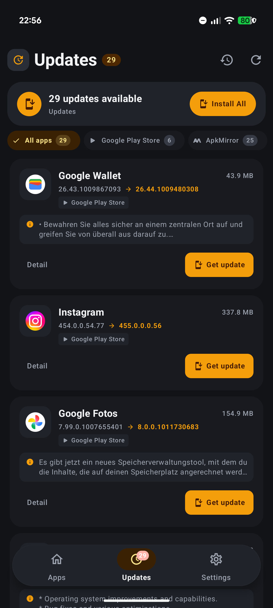
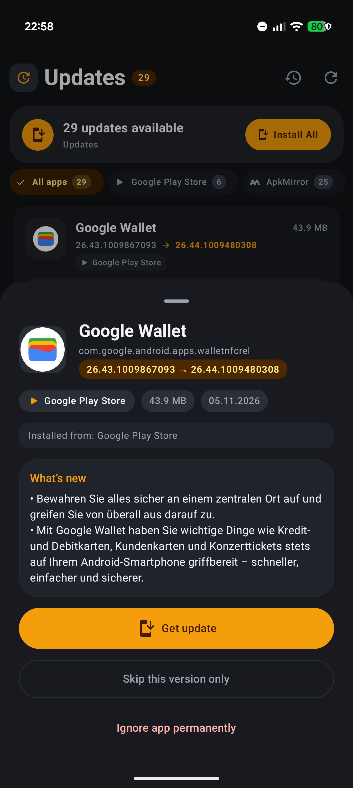
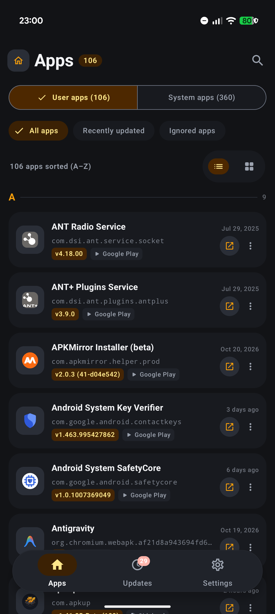
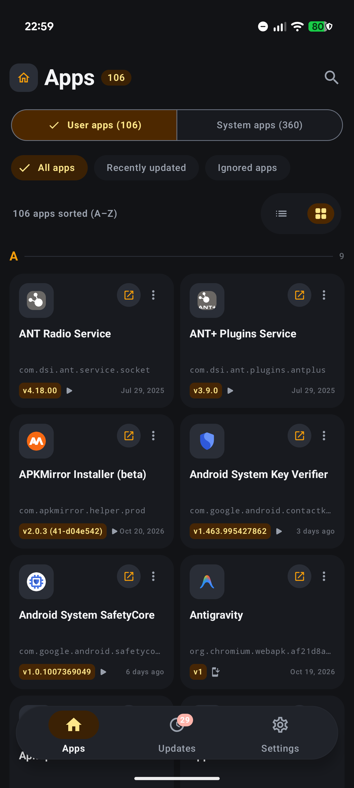
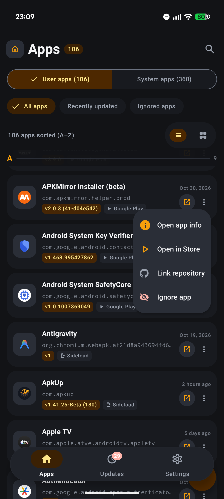
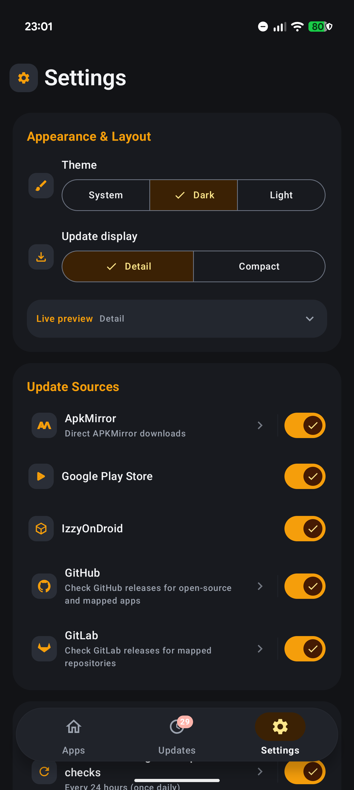
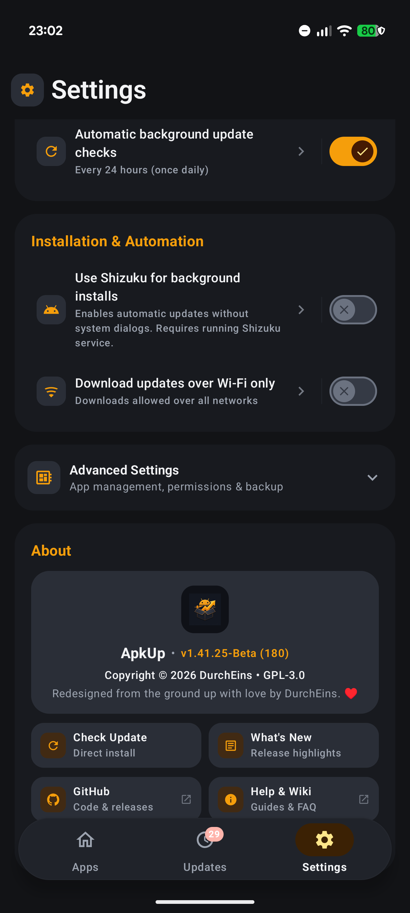
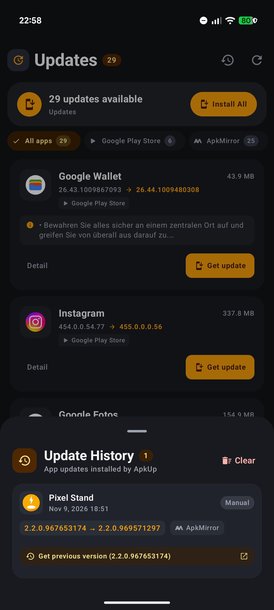
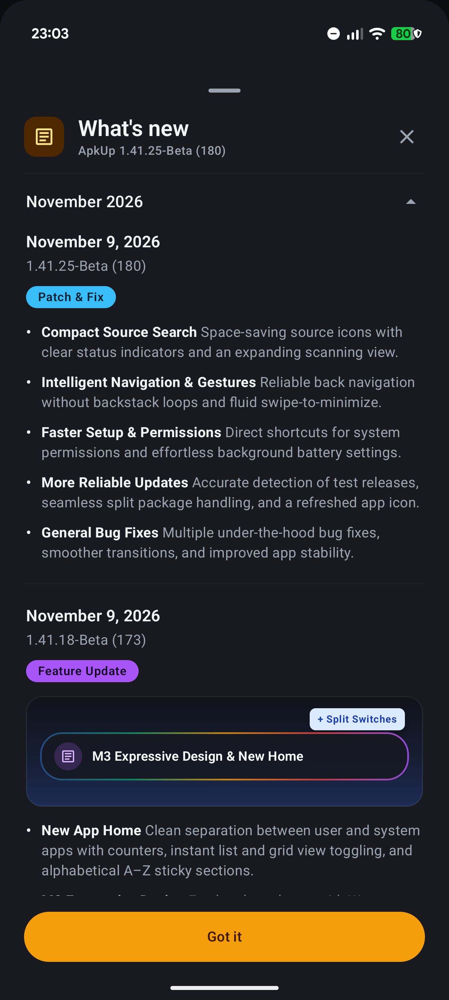

# ApkUp

<p align="center">
  
</p>

<p align="center">
  <b>A modern open-source Android application for discovering, managing, and autonomously installing app updates across multiple sources (Google Play, APKMirror, IzzyOnDroid, Custom F-Droid Index V2, GitHub, GitLab &amp; Codeberg/Forgejo) featuring Material 3 Expressive design, Shizuku &amp; optional Root background updates, Watchlist tracking, APK export, and a clean Google Pixel aesthetic.</b>
</p>

<p align="center">
  <a href="https://github.com/DurchEins/apkup/releases/latest"></a>
  
  
  
  
</p>

<p align="center">
  <a href="#-features">Features</a> • <a href="#-requirements">Requirements</a> • <a href="#-tech-stack">Tech Stack</a> • <a href="#-screenshots">Screenshots</a> • <a href="#-downloads">Downloads</a> • <a href="#-troubleshooting--wiki">Wiki</a> • <a href="#-license--credits">License</a>
</p>

---

## ✨ Features

* **🚀 Robust Update Sources & Self-Updater:**
  * **Google Play Store:** Direct store query with accurate delta version recognition and automatic HTTP 429 rate-limit recovery.
  * **APKMirror In-App Downloads:** Direct in-app downloading and installation (including `.apkm` split-bundle extraction) with intelligent concurrency throttling, transient retries, and automatic 10-minute per-app Cloudflare browser fallback.
  * **IzzyOnDroid & Custom F-Droid Repositories (Index V2):** Full F-Droid Index V2 specification support (with automatic legacy `index-v1.jar` fallback) for IzzyOnDroid plus custom third-party F-Droid repositories with ready-to-use presets (*Official F-Droid*, *NewPipe*, *Guardian Project*, etc.) and SHA-256 fingerprint validation.
  * **GitHub, GitLab & Codeberg / Forgejo:** Built-in recognition for popular FOSS projects plus 3-way repository bindings (`owner/repo`, self-hosted GitLab/Forgejo instances, multi-level subgroups, token verification sheets, optional asset regex filtering, and FOSS flavor preference).
  * **Watch Uninstalled Apps:** Track releases for apps that are not yet installed via the **`+`** button in *Apps* and the *Watched* filter — discovered releases appear directly in *Updates* ready for one-tap installation or APK export.
  * **Obtainium Interoperability with Preview:** Seamlessly import app configurations, custom F-Droid repositories, and watchlist candidates from Obtainium JSON exports via an interactive preview sheet, and export your setup back into Obtainium-compatible format.
  * **ApkUp Self-Updater:** Automatic release checks and direct in-app updating without relying on external app stores.
* **🎨 Material 3 Expressive Design:**
  * Pixel-inspired UI optimized for Android 15, 16, and 17 styling with a floating capsule navigation dock, collapsible scroll headers, and unified modal bottom sheets across Settings and Repository Linking.
  * Comprehensive **Dynamic Color (Material You)** support with dark, light, and system themes.
  * Instant search bars and flexible sorting across both **Updates** (*Name A–Z / Z–A, Source, Newest Release Date*) and **Apps** (*Name A–Z / Z–A, Source, Recently Updated*).
  * Monthly-grouped in-app changelog with semantic release tags, expandable month accordions, and visual highlight banners.
  * **Compact Source Scan:** Space-saving update source icons with real-time status checkmarks and dynamic accordion scan expansion.
  * **Tiered Predictive Back Navigation:** Context-aware back gesture handling that dismisses active searches, smoothly navigates back from secondary tabs to Updates, and supports fluid swipe-to-minimize.
  * Multiple display modes for the update list (*Compact Grid Tiles* vs. *Detailed List*).
  * Auto-resizing typography ensuring multi-digit version numbers always display cleanly on a single line.
* **⚡ Uninterrupted Background Downloads, APK Export, 24h Cache & Autonomous Installs:**
  * **Autonomous Background Updates (Shizuku & Optional Root `su`):** Optional zero-touch background pipeline powered by Shizuku and Android `WorkManager` — plus an optional Root (`su`) installer fallback with live availability check on rooted devices — with configurable **Wi-Fi only** and **While charging** guards.
  * **Save APK & Split `.apks` Bundles:** Export single `.apk` installers or bundled `.apks` split packages directly into `Download/ApkUp/` (or any custom SAF folder configured in Setup) without installing.
  * **Batch Overall Progress, Transfer Speed & ETA:** *Update All*, multi-select batches, the active queue sheet, and system notifications show overall completion percentage, live speed, and estimated time remaining.
  * **Consolidated Summary Notifications & Update History:** Clean post-update summary notification plus a persistent in-app **Update History** sheet (accessible anytime from the *Updates* top bar or the *Recently Updated* filter in *Apps*) recording version transitions (`old → new`), update source, install mode (*Auto · Shizuku*, *Auto · Root*, vs. *Manual*), and a one-tap **Previous Version** link to simplify rollbacks if an upstream release introduces issues.
  * **Foreground Download Service:** Interactive downloads, multi-select batch installs (long-press any update card), and *Update All* continue reliably in the background and across screen locks, complete with live progress notifications and instant cancellation.
  * **24-Hour Smart Cache & Instant Resume:** Downloaded APKs are preserved locally for up to 24 hours. Dismissed installations can be resumed instantly with "Install" without re-downloading.
  * **Direct Permission Setup, Battery Navigation & Diagnostic Log:** Deep-links directly to Android's app battery usage page, provides guided in-app setup sheets for Shizuku and Root (`su`), and lets you save or share a sanitized **Diagnostic & Update Log** (`.txt`) from Advanced Settings.
  * **Reliable Native Fallback:** Seamless fallback to Android's `PackageInstaller` session API with Android 14+ Background Activity Launch (BAL) notification support and robust session abandonment.
* **📶 Network Data Saver:**
  * **Wi-Fi Only Mode:** Restrict downloads to unmetered Wi-Fi connections with an active mobile data safety prompt.
* **🛡️ Smart Version Detection & Filters:**
  * **Zero False Positives:** Verifiable semantic version and `versionCode` progression check with robust numeric pre-release comparison.
  * **Hardened Archive Extraction:** Defense-in-depth safety limits during bundle extraction to safeguard storage against excessively large or malicious archives.
  * **Skip Single Version:** Ignore a specific faulty build once; you will be notified again when a newer release arrives.
  * **Permanently Hidden Apps:** Exclude apps permanently from the update cycle and manage them anytime.
  * **System Apps Toggle:** Filter or include pre-installed system applications on demand.
* **⏰ Background Worker & Notifications:**
  * Periodic update checks powered by Android `WorkManager` (configurable: 6h, 12h, 24h, 48h, or 7 days).
  * Informative system notifications alerting you when new updates are ready to install.
* **📖 Troubleshooting & Help Wiki:**
  * One-tap contextual help buttons on repository errors plus a dedicated **Help & Wiki** Bento shortcut in Settings that link directly to step-by-step guides in the [ApkUp GitHub Wiki](https://github.com/DurchEins/apkup/wiki).
* **💾 Configuration Backup & Restore:**
  * Export and import your entire setup, autonomous Shizuku rules, custom repository bindings, ignored apps, and skipped versions via a single JSON file (plus full Obtainium JSON import/export).
* **🔒 Privacy First:**
  * No ads. No telemetry. No user tracking. Pure open source.

---

## 📥 Requirements

* **Minimum:** Android 10.0 (API Level 29) or higher.
* **Recommended:** Android 12+ for full Dynamic Color theming and [Shizuku](https://shizuku.rikka.app/) for silent background installations.

---

## 🛠️ Tech Stack

* **Language:** Kotlin 2.3+
* **UI Framework:** Jetpack Compose & Material 3 Expressive
* **Architecture:** MVVM with Coroutines & Reactive StateFlow
* **Dependency Injection:** Koin
* **Network & Parsing:** Retrofit 3, OkHttp 5, Jsoup
* **Privileged Install:** Shizuku API 13.x
* **Background Tasks:** AndroidX WorkManager & Foreground Service (`dataSync`)
* **SDK Compatibility:** Min SDK 29 (Android 10.0) | Target SDK 37 (Android 17)

---

## 📸 Screenshots

<p align="center">
  
  &nbsp;&nbsp;
  
  &nbsp;&nbsp;
  
</p>

<p align="center">
  
  &nbsp;&nbsp;
  
  &nbsp;&nbsp;
  
</p>

<p align="center">
  
  &nbsp;&nbsp;
  
  &nbsp;&nbsp;
  
</p>

---

## 📲 Downloads

Get the latest release of ApkUp from your preferred platform:

<p align="center">
  <a href="https://github.com/DurchEins/apkup/releases/latest"></a>&nbsp;&nbsp;
  <a href="https://gitlab.com/DurchEins1/apkup/-/releases"></a>&nbsp;&nbsp;
  <a href="https://apkpure.com/apkup/com.apkup"></a>&nbsp;&nbsp;
  <a href="https://www.amazon.com/gp/product/B0HR5TXL8R"></a>
</p>

---

## 📖 Troubleshooting & Wiki

Need help configuring sources or resolving connection errors? Visit the official **[ApkUp Wiki](https://github.com/DurchEins/apkup/wiki)** for step-by-step guides:

* [Troubleshooting Source Errors](https://github.com/DurchEins/apkup/wiki/Troubleshooting-Source-Errors)
* [Configuring GitHub, GitLab & Codeberg Personal Access Tokens](https://github.com/DurchEins/apkup/wiki/Configuring-GitHub-&-GitLab-Tokens)
* [Setting up Shizuku & Optional Root (`su`) for Silent Updates](https://github.com/DurchEins/apkup/wiki/Setting-up-Shizuku)
* [Obtainium Migration & Sync Guide](https://github.com/DurchEins/apkup/wiki/Obtainium-Migration-&-Sync-Guide)
* [F-Droid & Index V2 Repositories](https://github.com/DurchEins/apkup/wiki/F-Droid-&-Index-V2-Repositories)

---

## 📜 License & Credits

This project is licensed under the **[GNU General Public License v3.0 (GPL-3.0)](LICENSE)** — see the [LICENSE](LICENSE) file for full details.

```text
ApkUp – Copyright (C) 2026 DurchEins
Portions Copyright (C) 2016–2024 rumboalla (based on the original project APKUpdater)

This program is free software: you can redistribute it and/or modify
it under the terms of the GNU General Public License as published by
the Free Software Foundation, either version 3 of the License, or
(at your option) any later version.

This program is distributed in the hope that it will be useful,
but WITHOUT ANY WARRANTY; without even the implied warranty of
MERCHANTABILITY or FITNESS FOR A PARTICULAR PURPOSE. See the
GNU General Public License for more details.

You should have received a copy of the GNU General Public License
along with this program. If not, see <https://www.gnu.org/licenses/>.
```

> **Special Thanks:**  
> Based on the original open-source project by **[rumboalla (APKUpdater)](https://github.com/rumboalla/apkupdater)**.
