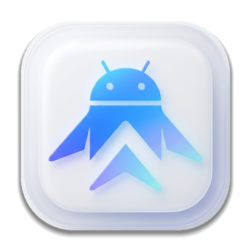

# ApkUp

<p align="center">
  
</p>

<p align="center">
  <b>A modern open-source Android app for managing and installing app updates (Google Play, APKMirror, IzzyOnDroid, GitHub & GitLab) featuring Material 3 Expressive design, Shizuku integration, and a clean Google Pixel aesthetic.</b><br>
  <i>Eine moderne Open-Source-Android-App zur Verwaltung und Installation von App-Updates (Google Play, APKMirror, IzzyOnDroid, GitHub & GitLab) mit Material 3 Expressive Design, Shizuku-Unterstützung und minimalistischem Pixel-Look.</i>
</p>

<p align="center">
  
  
  
  
  
</p>

<p align="center">
  <a href="#english">English</a> • <a href="#deutsch">Deutsch</a> • <a href="#-screenshots">Screenshots</a> • <a href="#-license--credits">License</a>
</p>

---

<a name="english"></a>
## 🇬🇧 English

### ✨ Features
* **🚀 Robust Update Sources & Self-Updater:**
  * **Google Play Store:** Direct store query with accurate delta version recognition and automatic HTTP 429 rate-limit recovery.
  * **APKMirror In-App Downloads:** Direct in-app downloading and installation (including `.apkm` split-bundle extraction) with polite rate-limiting and automatic Cloudflare browser fallback.
  * **IzzyOnDroid:** Curated open-source repository with mandatory SHA-256 certificate validation and ABI filtering.
  * **GitHub & GitLab:** Built-in recognition for popular FOSS projects plus custom repository binding (`owner/repo` or self-hosted GitLab).
  * **ApkUp Self-Updater:** Automatic release checks and direct in-app updating without relying on external app stores.
* **🎨 Material 3 Expressive Design:**
  * Pixel-inspired UI optimized for Android 15/16/17 styling with floating capsule navigation and tactile haptic feedback.
  * Comprehensive **Dynamic Color (Material You)** support with dark, light, and system themes.
  * Multiple display modes for the update list (*Compact Grid Tiles* vs. *Detailed List*).
  * **Interactive Live Queue Sheet:** Play-Store-style bottom sheet and banner with per-app live progress, queuing, and individual or full-queue abort controls.
* **⚡ Uninterrupted Background Downloads, 24h Cache & Shizuku:**
  * **Foreground Download Service:** Downloads and batch updates (*Update All*) continue reliably in the background and across screen locks, complete with live progress notifications and instant cancellation.
  * **24-Hour Smart Cache & Instant Resume:** Downloaded APKs are preserved locally for up to 24 hours. Dismissed installations can be resumed instantly with "Install" without re-downloading.
  * **Silent Shizuku Installs:** Unattended background updates without repeated permission dialogs when connected to Shizuku.
  * **Reliable Native Fallback:** Seamless fallback to Android's `PackageInstaller` session API with Android 14+ Background Activity Launch (BAL) notification support and robust session abandonment.
* **📶 Network Data Saver & Masked Security:**
  * **Wi-Fi Only Mode:** Restrict downloads to unmetered Wi-Fi connections with an active mobile data safety prompt.
  * **Masked API Tokens:** Password-style masked input with eye visibility toggle for GitHub & GitLab Personal Access Tokens.
* **🛡️ Smart Version Detection & Filters:**
  * **Zero False Positives:** Verifiable semantic version and `versionCode` progression check.
  * **Skip Single Version:** Ignore a specific faulty build once; you will be notified again when a newer release arrives.
  * **Permanently Hidden Apps:** Exclude apps permanently from the update cycle and manage them anytime.
  * **System Apps Toggle:** Filter or include pre-installed system applications on demand.
* **⏰ Background Worker & Notifications:**
  * Periodic update checks powered by Android `WorkManager` (configurable: 6h, 12h, 24h, 48h, or 7 days).
  * Informative system notifications alerting you when new updates are ready to install.
* **💾 Configuration Backup & Restore:**
  * Export and import your entire setup, custom repository bindings, ignored apps, and skipped versions via a single JSON file.
* **🔒 Privacy First:**
  * No ads. No telemetry. No user tracking. Pure open source.

### 🛠️ Tech Stack
* **Language:** Kotlin 2.3+
* **UI Framework:** Jetpack Compose & Material 3 Expressive
* **Architecture:** MVVM with Coroutines & Reactive StateFlow
* **Dependency Injection:** Koin
* **Network & Parsing:** Retrofit 3, OkHttp 5, Jsoup
* **Privileged Install:** Shizuku API 13.x
* **Background Tasks:** AndroidX WorkManager & Foreground Service (`dataSync`)

### 📥 Requirements
* **Minimum:** Android 10.0 (API Level 29) or higher.
* **Recommended:** Android 12+ for full Dynamic Color theming and [Shizuku](https://shizuku.rikka.app/) for silent background installations.

---

## 📸 Screenshots

<p align="center">
  
  &nbsp;&nbsp;
  
  &nbsp;&nbsp;
  
</p>

<p align="center">
  
  &nbsp;&nbsp;
  
  &nbsp;&nbsp;
  
</p>

<p align="center">
  
  &nbsp;&nbsp;
  
  &nbsp;&nbsp;
  
</p>

---

<a name="deutsch"></a>
## 🇩🇪 Deutsch

### ✨ Funktionen
* **🚀 Leistungsstarke Update-Quellen & Self-Updater:**
  * **Google Play Store:** Direkte Store-Abfrage mit präziser Erkennung von Versionssprüngen und automatischer HTTP-429-Ratenlimit-Erholung.
  * **APKMirror In-App-Direktdownload:** Direkter Download und Installation in der App (inkl. Entpacken von `.apkm`-Split-Bundles) mit intelligentem Rate-Limiting und automatischem Cloudflare-Browser-Fallback.
  * **IzzyOnDroid:** Kuratiertes Open-Source-Repository mit verpflichtendem SHA-256-Signaturabgleich und ABI-Filterung.
  * **GitHub & GitLab:** Integrierte Erkennung bekannter Open-Source-Apps sowie freie Verknüpfung eigener Repositories (`owner/repo` oder Self-Hosted GitLab).
  * **ApkUp Self-Updater:** Automatische Release-Prüfung und komfortable In-App-Aktualisierung ohne externe App-Stores.
* **🎨 Material 3 Expressive Design:**
  * Authentische Ästhetik im Stil moderner Google-Pixel-Flaggschiffe (Android 15/16/17) mit schwebendem Capsule-Dock und haptischem Feedback.
  * Vollständige Unterstützung von **Dynamic Color (Material You)** sowie Dark-, Light- und System-Theming.
  * Wählbare Ansichten für den Updates-Tab (*Kompakte Kacheln* vs. *Detaillierte Liste*).
  * **Interaktive Live-Warteschlange:** Panel im Play-Store-Stil mit Live-Fortschrittsbalken pro App, Warteschlange und Einzel- oder Gesamtabbruch.
* **⚡ Unterbrechungsfreie Hintergrund-Downloads, 24h-Cache & Shizuku:**
  * **Foreground Download Service:** Downloads und Sammel-Updates (*Alle aktualisieren*) laufen zuverlässig im Hintergrund und bei gesperrtem Bildschirm weiter – inklusive Live-Fortschrittsbenachrichtigung und Sofort-Abbruch.
  * **24-Stunden-Installationscache & Sofort-Fortsetzung:** Heruntergeladene APKs bleiben bis zu 24 Stunden lokal gespeichert. Abgebrochene Dialoge können sofort ohne erneuten Download über „Installieren“ fortgesetzt werden.
  * **Stille Shizuku-Installation:** Vollautomatische Hintergrund-Installation ohne manuelle Bestätigungs-Dialoge bei aktiver Shizuku-Verbindung.
  * **Zuverlässiger System-Fallback:** Nahtloser Rückgriff auf die native Android `PackageInstaller`-Session-API mit Android 14+ Background Activity Launch (BAL) Benachrichtigungs-Support und sauberer Sitzungs-Freigabe.
* **📶 Datensparmodus & Maskierte Sicherheit:**
  * **WLAN-Only Modus:** Downloads optional auf ungedeckelte WLAN-Verbindungen beschränken inklusive Sicherheitsabfrage bei mobilen Daten.
  * **Maskierte API-Tokens:** Geschützte Passworteingabe mit Auge-Symbol zum sicheren Ein- und Ausblenden von GitHub- & GitLab-Tokens.
* **🛡️ Präziser Versionsabgleich & Filter:**
  * **Keine False-Positives:** Exakte Erkennung höherer Versionsnummern und Build-Codes (`versionCode`).
  * **Übersprungene Einzel-Updates:** Eine fehlerhafte Version gezielt einmalig ignorieren – bei einem neueren Update wird wieder benachrichtigt.
  * **Dauerhaft verborgene Apps:** Apps dauerhaft aus dem Update-Zyklus ausschließen und übersichtlich verwalten.
  * **System-Apps-Filter:** Flexible Ein- oder Ausblendung von vorinstallierten Systemanwendungen.
* **⏰ Zuverlässige Hintergrundprüfung & Benachrichtigungen:**
  * Periodische Update-Prüfung via Android `WorkManager` (wählbare Intervalle: 6h, 12h, 24h, 48h oder 7 Tage).
  * Informative System-Benachrichtigung bei neuen Updates mit Direkt-Sprung in die App.
* **💾 Backup & Wiederherstellung:**
  * Export und Import aller Einstellungen, verknüpften Repositories, ignorierten Apps und Versionen als JSON-Datei.
* **🔒 Privatsphäre garantiert:**
  * Keine Werbung. Kein Tracking. Keine Telemetrie. Vollständig Open Source.

### 🛠️ Technische Basis
* **Sprache:** Kotlin 2.3+
* **UI:** Jetpack Compose & Material 3 Expressive
* **Architektur:** MVVM mit Kotlin Coroutines & Reactive StateFlow
* **Dependency Injection:** Koin
* **Networking & Parsing:** Retrofit 3, OkHttp 5, Jsoup
* **Rootless ADB / Elevated Privileges:** Shizuku API 13.x
* **Background Processing:** AndroidX WorkManager & Foreground Service (`dataSync`)

### 📥 Voraussetzungen
* **Mindestversion:** Android 10 (API Level 29) oder höher.
* **Empfohlen:** Android 12+ für adaptive Dynamic Color Akzente und [Shizuku](https://shizuku.rikka.app/) für Silent Updates.

---

<a name="-license--credits"></a>
## 📜 License & Credits / Lizenz & Danksagung

This project is licensed under the **[MIT License](LICENSE)**.

```
Copyright (c) 2026 DurchEins
Portions Copyright (c) 2017-2024 rumboalla (based on the original project APKUpdater)
```

> **Special Thanks / Besonderer Dank:**  
> Based on the original open-source project by **[rumboalla (APKUpdater)](https://github.com/rumboalla/apkupdater)**.
