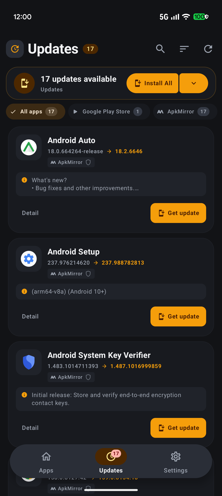
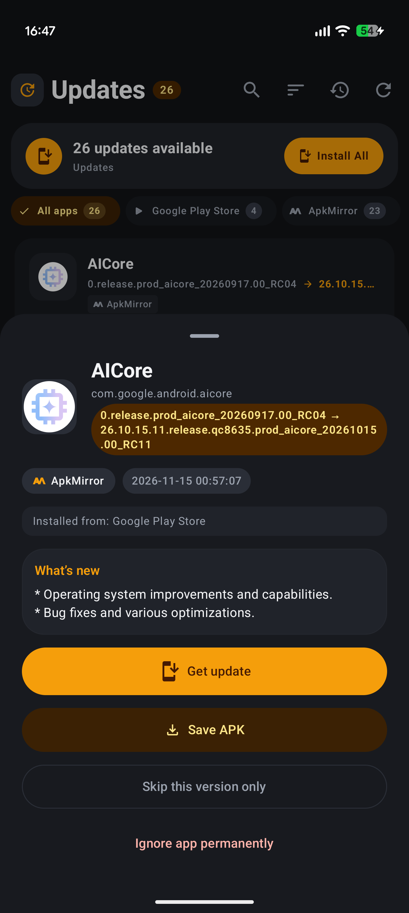
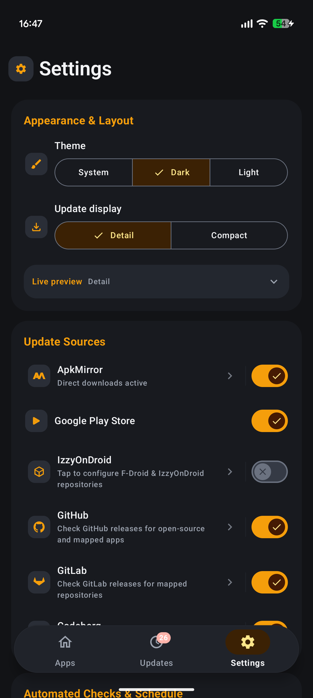
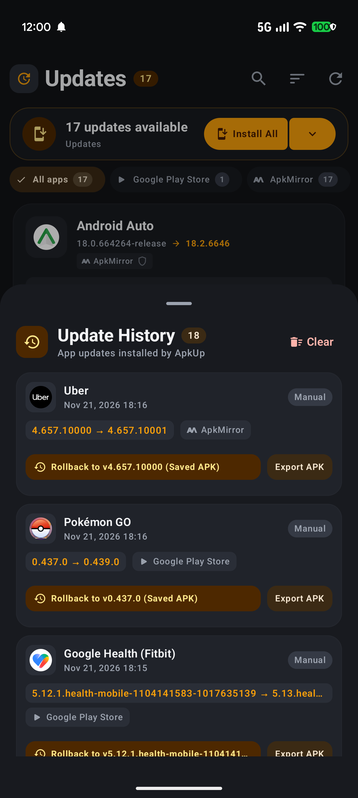

# ApkUp

<p align="center">
  
</p>

<p align="center">
  <b>A modern open-source Android application for discovering, verifying, and autonomously installing app updates across multiple sources (Google Play, F-Droid &amp; IzzyOnDroid, APKMirror, GitHub, GitLab &amp; Codeberg/Forgejo) featuring Material 3 Expressive design, cryptographic APK signature verification, Watchlist tracking, APK export, and unattended Shizuku &amp; optional Root background updates.</b>
</p>

<p align="center">
  <a href="https://github.com/DurchEins/apkup/releases/latest"></a>
  
  
  
  
</p>

<p align="center">
  <a href="#-features">Features</a> • <a href="#-requirements">Requirements</a> • <a href="#-tech-stack">Tech Stack</a> • <a href="#-screenshots">Screenshots</a> • <a href="#-downloads">Downloads</a> • <a href="#-troubleshooting--wiki">Wiki</a> • <a href="#-license--credits">License</a>
</p>

---

## ✨ Features

* **🚀 Multi-Source Update Engine & Self-Updater:**
  * **F-Droid & IzzyOnDroid Multi-Repo Engine:** Native support for official F-Droid, IzzyOnDroid, and custom HTTPS F-Droid repositories (`?fingerprint=…`) with cryptographic JAR certificate verification (`entry.jar` / `index-v1.jar`), incremental Index-V2 diffs (`RFC 7396`) with per-diff SHA-256 verification, and per-APK SHA-256 checksum validation.
  * **Google Play Store:** Anonymous store delta queries with automatic HTTP 429 rate-limit recovery and privacy-minimized device compatibility profiles.
  * **APKMirror In-App Downloads:** Direct in-app downloading and `.apkm` split-bundle installation with automatic in-app Cloudflare WebView verification, intelligent concurrency throttling, 10-minute per-app cooldown, and seamless browser fallback on anti-bot challenges.
  * **GitHub, GitLab & Codeberg / Forgejo:** Built-in mappings for popular FOSS apps, batched GraphQL update queries when a GitHub token is configured, and 3-way custom repository bindings (`owner/repo`, self-hosted GitLab/Forgejo instances, multi-level subgroup paths, token verification sheets, optional asset regex filtering, and FOSS flavor preference) with strict host-isolated token handling.
  * **Watch Uninstalled Apps:** Track releases for apps that are not yet installed via the **`+`** button in *Apps* and the *Watched* filter — discovered releases appear directly in *Updates* ready for one-tap installation or APK export.
  * **Obtainium Interoperability with Preview:** Import app configurations, custom F-Droid repositories, and watchlist candidates from Obtainium exports via an interactive preview sheet, and export custom bindings back to Obtainium JSON.
  * **Verified Self-Updater:** Checks official GitHub releases and validates `SHA256SUMS` digests plus APK signing certificates before installing updates.
* **🛡️ Defense-in-Depth Security & Privacy:**
  * **Pre-Install APK Signature & Downgrade Verification:** Cryptographically verifies APK Signature Scheme v2/v3 certificates against the installed app before launching `PackageInstaller`, Shizuku, or Root (`su`), blocking certificate mismatches and version downgrades.
  * **Onboarding Source Consent:** Transparent first-launch source selection ensures zero external network requests happen before you choose your preferred update sources.
  * **Encrypted Local Storage:** Preferences and optional API tokens are encrypted at rest via **Google Tink (AES-256-GCM)** in Android Keystore, with cloud backups and cleartext HTTP strictly disabled.
  * **Tapjacking & Archive Hardening:** Touch events are filtered when obscured by overlays, and `.apkm` extraction enforces strict Zip-Slip and decompression-bomb limits inside private internal storage.
* **🎨 Material 3 Expressive Design & 9 Official Languages:**
  * Pixel-inspired UI with Dynamic Color (Material You), dark/light/system themes, floating capsule navigation dock, collapsible scroll headers, unified modal bottom sheets, and tiered predictive back navigation.
  * Instant search bars and flexible sorting across both **Updates** (*Name A–Z / Z–A, Source, Newest Release Date*) and **Apps** (*Name A–Z / Z–A, Source, Recently Updated*).
  * Localized in **9 official languages**: English, German, Spanish, French, Portuguese, Italian, Russian, Simplified Chinese, and Japanese.
  * Multiple display modes (*Compact Grid Tiles* vs. *Detailed List*), quick-filter chips (including *GitHub / Sideload* and *Watched*), and monthly-grouped in-app changelogs.
* **⚡ Reliable WorkManager Downloads, APK Export, 24h Cache & Autonomous Installs:**
  * **User-Initiated Data Transfer Worker & Batch ETA:** Interactive downloads, multi-select batch installs (long-press any update card), and filtered batch updates (*Install All*) run reliably via AndroidX `WorkManager` (`UpdateDownloadWorker`) with live overall batch percentage, smoothed transfer speed, ETA, and instant per-item or global cancellation.
  * **Save APK & Split `.apks` Bundles:** Export single `.apk` installers or bundled `.apks` split packages directly into `Download/ApkUp/` (or any custom SAF folder configured in Setup) without installing.
  * **Autonomous Background Updates (Shizuku & Optional Root `su`):** Optional zero-touch Shizuku or Root (`su`) pipeline with live availability checks, configurable **Wi-Fi only** and **While charging** guards, consolidated summary notifications, a sanitized **Diagnostic & Update Log** (`.txt`), and a persistent **Update History** sheet.
  * **24-Hour Smart Cache & Instant Resume:** Verified APKs in private cache can be installed without re-downloading, with automatic Android 14+ Background Activity Launch (BAL) prompt fallback.

---

## 📥 Requirements

* **Minimum:** Android 10.0 (API Level 29) or higher.
* **Recommended:** Android 12+ for Dynamic Color theming and [Shizuku](https://shizuku.rikka.app/) for silent background installations.

---

## 🛠️ Tech Stack

* **Language:** Kotlin 2.3+
* **UI Framework:** Jetpack Compose & Material 3 Expressive
* **Architecture:** MVVM with Coroutines & Reactive StateFlow
* **Dependency Injection:** Koin 4.2
* **Cryptography & Storage:** Google Tink Android 1.20 (`AES-256-GCM`), `apksig` v2/v3 verification
* **Network & Parsing:** Retrofit 3, OkHttp 5, Jsoup
* **Privileged Install:** Shizuku API 13.x & optional `su` Root session installer
* **Background Tasks:** AndroidX WorkManager 2.11 (`User-Initiated Data Transfer` & Periodic Workers)
* **SDK Compatibility:** Min SDK 29 (Android 10.0) | Target & Compile SDK 37 (Android 17)

---

## 📸 Screenshots

<p align="center">
  
  &nbsp;&nbsp;
  
  &nbsp;&nbsp;
  
</p>

<p align="center">
  
  &nbsp;&nbsp;
  
  &nbsp;&nbsp;
  
</p>

<p align="center">
  
  &nbsp;&nbsp;
  
  &nbsp;&nbsp;
  
</p>

---

## 📲 Downloads

Get the latest release of ApkUp from your preferred platform:

<p align="center">
  <a href="https://github.com/DurchEins/apkup/releases/latest"></a>&nbsp;&nbsp;
  <a href="https://zapstore.dev/apps/com.apkup"></a>&nbsp;&nbsp;
  <a href="https://gitlab.com/DurchEins1/apkup/-/releases"></a>&nbsp;&nbsp;
  <a href="https://apkpure.com/apkup/com.apkup"></a>&nbsp;&nbsp;
  <a href="https://www.amazon.com/gp/product/B0HR5TXL8R"></a>
</p>

---

## 📖 Troubleshooting & Wiki

Need help configuring sources or resolving connection errors? Visit the official **[ApkUp Wiki](https://github.com/DurchEins/apkup/wiki)** for step-by-step guides:

* [Troubleshooting Source Errors](https://github.com/DurchEins/apkup/wiki/Troubleshooting-Source-Errors)
* [Configuring GitHub, GitLab & Codeberg Personal Access Tokens](https://github.com/DurchEins/apkup/wiki/Configuring-GitHub-&-GitLab-Tokens)
* [Setting up Shizuku & Optional Root (`su`) for Silent Updates](https://github.com/DurchEins/apkup/wiki/Setting-up-Shizuku)
* [Obtainium Migration & Sync Guide](https://github.com/DurchEins/apkup/wiki/Obtainium-Migration-&-Sync-Guide)
* [F-Droid & Index V2 Repositories](https://github.com/DurchEins/apkup/wiki/F-Droid-&-Index-V2-Repositories)

---

## 📜 License & Credits

This project is licensed under the **[GNU General Public License v3.0 (GPL-3.0)](LICENSE)** — see the [LICENSE](LICENSE) file for full details.

```text
ApkUp – Copyright (C) 2026 DurchEins
Portions Copyright (C) 2016–2024 rumboalla (based on the original project APKUpdater)

This program is free software: you can redistribute it and/or modify
it under the terms of the GNU General Public License as published by
the Free Software Foundation, either version 3 of the License, or
(at your option) any later version.

This program is distributed in the hope that it will be useful,
but WITHOUT ANY WARRANTY; without even the implied warranty of
MERCHANTABILITY or FITNESS FOR A PARTICULAR PURPOSE. See the
GNU General Public License for more details.

You should have received a copy of the GNU General Public License
along with this program. If not, see <https://www.gnu.org/licenses/>.
```

> **Special Thanks:**  
> Based on the original open-source project by **[rumboalla (APKUpdater)](https://github.com/rumboalla/apkupdater)**.
