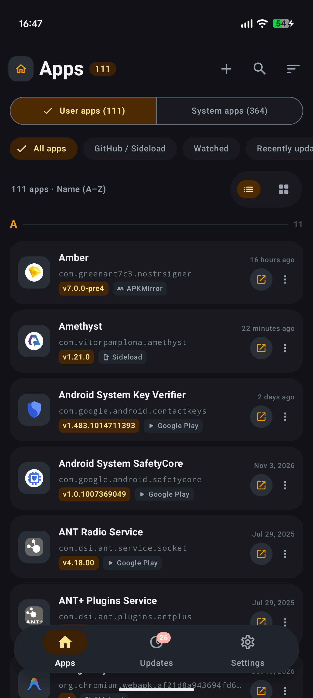
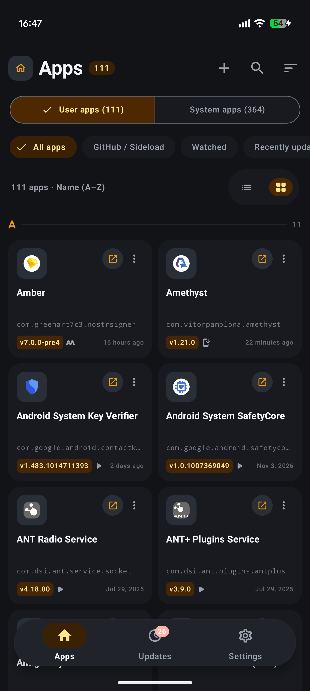
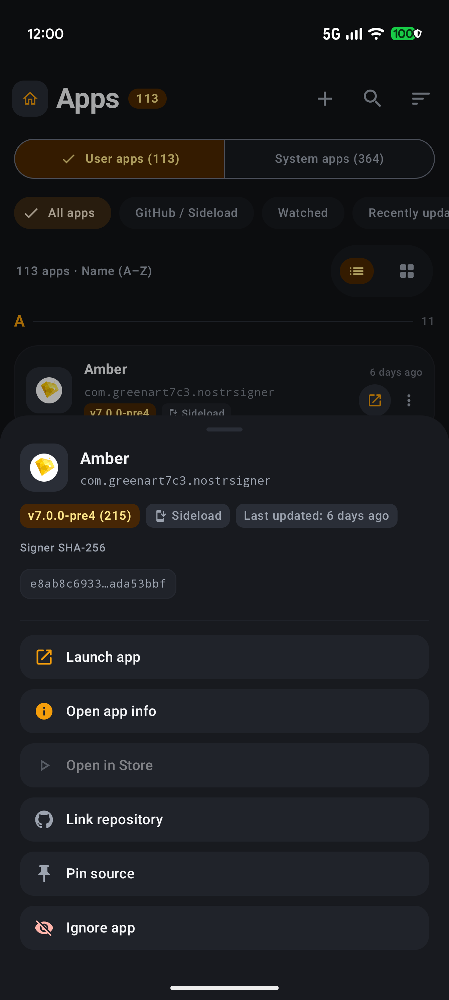
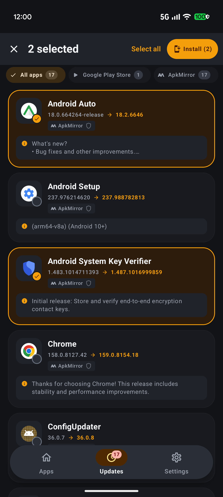
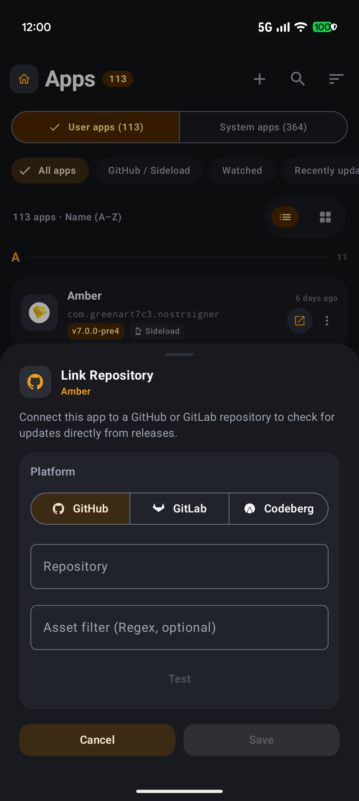
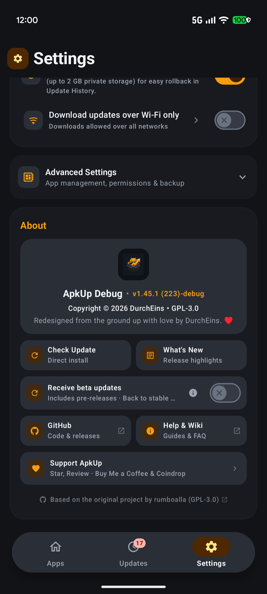
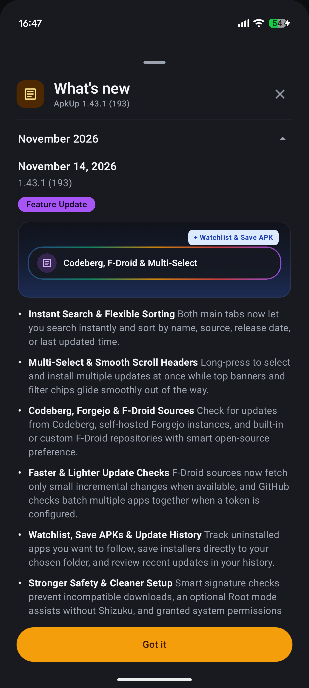
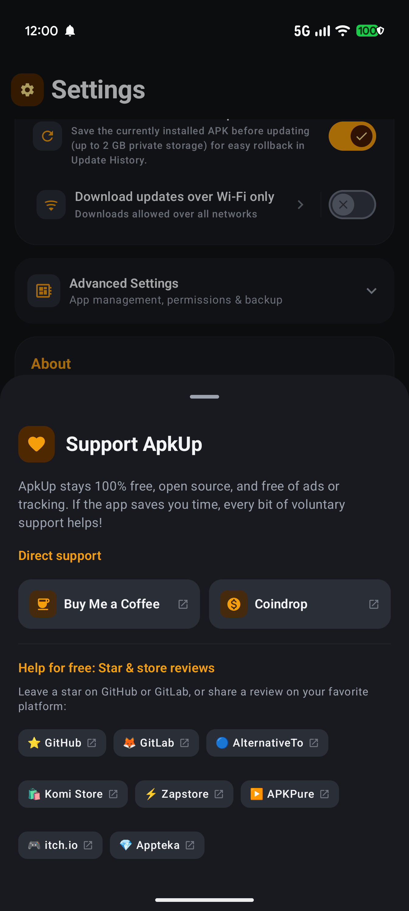

<!--
   ╔══════════════════════════════════════════════════════════════════╗
   ║     _          _    _   _                                        ║
   ║    / \   _ __ | | _| | | |_ __                                   ║
   ║   / _ \ | '_ \| |/ / | | | '_ \                                  ║
   ║  / ___ \| |_) |   <| |_| | |_) |                                 ║
   ║ /_/   \_\ .__/|_|\_\\___/| .__/   Multi-Source • Verified •      ║
   ║         |_|              |_|      Silent Android Updates         ║
   ║                                                                  ║
   ║  Thanks for peeking under the hood! Contributions welcome :)     ║
   ╚══════════════════════════════════════════════════════════════════╝
-->
<a name="top"></a>
<p align="center">
  <picture>
    <source media="(prefers-color-scheme: dark)" srcset=".github/assets/header-banner.svg">
    <source media="(prefers-color-scheme: light)" srcset=".github/assets/header-banner-light.svg">
    
  </picture>
</p>
<h1 align="center">ApkUp</h1>

<p align="center">
  <b>One updater. Six sources. Cryptographically verified.</b><br>
  <sub>Material 3 Expressive Android updater for Google Play, F-Droid (Index V2), IzzyOnDroid, APKMirror, GitHub, GitLab &amp; Codeberg — actively maintained APKUpdater successor with Watchlist, Obtainium sync, and silent Shizuku or Root installs.</sub>
</p>

<p align="center">
  <a href="https://durcheins.github.io/apkup/"><i>Homepage</i></a> • <a href="#-features">Features</a> • <a href="#-downloads">Downloads</a> • <a href="#-screenshots">Screenshots</a> • <a href="#%EF%B8%8F-requirements--tech-stack">Requirements &amp; Tech Stack</a> • <a href="#-quick-guides">Quick-Guides</a> • <a href="#-troubleshooting--wiki">Wiki</a> • <a href="#-support-apkup">Support</a> • <a href="#-translations">Translations</a>
</p>

<p align="center">
  <a href="https://github.com/DurchEins/apkup/releases/latest"></a>
  <a href="https://github.com/DurchEins/apkup/releases/latest"></a>
  
  <a href="PRIVACY.md"></a>
  <a href="LICENSE"></a>
</p>

<p align="center">
  <picture>
    <source media="(prefers-color-scheme: dark)" srcset=".github/assets/divider-dark.svg">
    <source media="(prefers-color-scheme: light)" srcset=".github/assets/divider-light.svg">
    
  </picture>
</p>

## ✨ Features

| 🚀 Multi-Source Engine | 🛡️ Security & Privacy |
| :--- | :--- |
| • **[6+ Update Sources](https://durcheins.github.io/apkup/wiki/#sources):** Google Play, [F-Droid (Index V2)](https://durcheins.github.io/apkup/wiki/#fdroid), IzzyOnDroid, APKMirror, GitHub, GitLab & Codeberg<br>• **[Custom Repositories](https://durcheins.github.io/apkup/wiki/#sources):** Link self-hosted GitLab/Forgejo repos & custom F-Droid feeds<br>• **[Priority & Pinning](https://durcheins.github.io/apkup/wiki/#sources):** Set preferred source order or pin apps to a specific source<br>• **[Pre-Release Channels](https://durcheins.github.io/apkup/wiki/#management):** Track Beta, RC, Alpha, or Nightly releases per app or globally | • **[Signature Protection](https://durcheins.github.io/apkup/wiki/#sha256):** Verifies app signing certificates before every install to block tampering<br>• **[Checksums & Downgrade Guard](https://durcheins.github.io/apkup/wiki/#sha256):** Validates SHA-256 checksums and prevents accidental downgrades<br>• **Encrypted Credentials:** Protects local settings and optional API tokens on-device<br>• **Privacy First:** Choose your sources on first launch — zero ads, zero tracking |

| ⚡ Downloads & Automation | 🎨 Design & Ecosystem |
| :--- | :--- |
| • **Batch Downloads & ETA:** Install multiple updates at once with live speed & remaining time<br>• **[Silent Background Updates](https://durcheins.github.io/apkup/wiki/#shizuku-deep):** Hands-free updates via Shizuku or optional Root with Wi-Fi & charging rules<br>• **APK Export & Smart Cache:** Save `.apk` / `.apks` files or install cached downloads without re-downloading<br>• **[Rollback Backups](https://durcheins.github.io/apkup/wiki/#management):** Optional pre-update backups & automatic device compatibility checks | • **Material 3 Expressive:** Brand-Amber theme, Dynamic Color, dark/light modes & smooth animations<br>• **9 Official Languages:** English, German, Spanish, French, Portuguese, Italian, Russian, Chinese & Japanese<br>• **Smart Link Routing:** Opens web links in matching installed apps first or in-app Chrome Custom Tabs<br>• **[Watchlist & Obtainium Sync](https://durcheins.github.io/apkup/wiki/#obtainium):** Track uninstalled apps and import/export Obtainium & App Watcher lists |

<details>
<summary><b>📋 Full Feature Breakdown</b></summary>

* **🚀 Multi-Source Update Engine & Self-Updater:**
  * **F-Droid & IzzyOnDroid Multi-Repo Engine:** Native support for official F-Droid, IzzyOnDroid, and custom HTTPS F-Droid repositories (`?fingerprint=…`) with cryptographic JAR certificate verification (`entry.jar` / `index-v1.jar`), incremental Index-V2 diffs (`RFC 7396`) with per-diff SHA-256 verification, and per-APK SHA-256 checksum validation ([Index-V2 Guide](https://github.com/DurchEins/apkup/wiki/F-Droid-%26-Index-V2-Repositories)).
  * **Google Play Store:** Anonymous store delta queries with automatic HTTP 429 rate-limit recovery and privacy-minimized device compatibility profiles.
  * **APKMirror In-App Downloads:** Direct in-app downloading and `.apkm` split-bundle installation with automatic in-app Cloudflare WebView verification, intelligent concurrency throttling, 10-minute per-app cooldown, and seamless browser fallback on anti-bot challenges.
  * **GitHub, GitLab & Codeberg / Forgejo:** Built-in mappings for popular FOSS apps, batched GraphQL update queries when a GitHub token is configured, and 3-way custom repository bindings (`owner/repo`, self-hosted GitLab/Forgejo instances, multi-level subgroup paths, token verification sheets, optional asset regex filtering, and FOSS flavor preference) with strict host-isolated token handling.
  * **Configurable Source Priority & Per-App Pinning:** Reorder update sources via drag-and-drop or arrow controls in *Setup*, pin individual apps to a preferred source with automatic fallback when no update is available there, and track active F-Droid repositories in a compact grouped scan tray.
  * **Pre-Release Channels & Background Time Window:** Selectively enable **Beta**, **RC**, **Alpha**, or **Nightly** channels globally or per app, and configure quiet hours or active time windows for background checks and auto-updates with automatic catch-up scheduling.
  * **Automatic Rollback Backups & Compatibility Guard:** Optionally back up installed APKs (including splits) before updating for in-place Root (`-r -d`) or guided non-Root rollbacks, with pre-install `minSdk` / `ABI` checks and a *Source Health & Cooldowns* sheet in *Setup* ([Troubleshooting](https://github.com/DurchEins/apkup/wiki/Troubleshooting-Source-Errors)).
  * **Watch Uninstalled Apps & App Watcher Import:** Track releases for apps that are not yet installed via the **`+`** button in *Apps* and the *Watched* filter, mark versions as *Seen*, or import watchlists directly from **App Watcher** exports.
  * **Obtainium Interoperability with Preview:** Import app configurations, custom F-Droid repositories, and watchlist candidates from Obtainium exports via an interactive preview sheet, and export custom bindings back to Obtainium JSON ([Obtainium Sync Guide](https://github.com/DurchEins/apkup/wiki/Obtainium-Migration-%26-Sync-Guide)).
  * **Verified Self-Updater with Optional Beta Channel:** Checks official GitHub releases (stable-only by default, with an opt-in <kbd>Receive beta updates</kbd> toggle under <kbd>Settings</kbd> ➔ <kbd>About</kbd> that cleanly returns to stable on opt-out) and validates `SHA256SUMS` digests plus APK signing certificates before installing updates.
* **🛡️ Defense-in-Depth Security & Privacy:**
  * **Pre-Install APK Signature & Downgrade Verification:** Cryptographically verifies APK Signature Scheme v2/v3 certificates against the installed app before launching `PackageInstaller`, Shizuku, or Root (`su`), blocking certificate mismatches and version downgrades ([Update Sources & Signature Protection](https://github.com/DurchEins/apkup/wiki/Update-Sources,-Repository-Linking-&-Signature-Protection)).
  * **Onboarding Source Consent:** Transparent first-launch source selection ensures zero external network requests happen before you choose your preferred update sources.
  * **Encrypted Local Storage:** Preferences and optional API tokens are encrypted at rest via **Google Tink (AES-256-GCM)** in Android Keystore, with cloud backups and cleartext HTTP strictly disabled.
  * **Tapjacking & Archive Hardening:** Touch events are filtered when obscured by overlays, and `.apkm` extraction enforces strict Zip-Slip and decompression-bomb limits inside private internal storage.
* **🎨 Material 3 Expressive Design & 9 Official Languages:**
  * Unified Brand-Amber color scheme with a soft off-white light theme, optional Dynamic Color (Material You) toggle, dark/light/system themes, floating capsule navigation dock (with automatic `NavigationRail` on tablets/wider displays), wavy progress indicators, split-button actions, collapsible scroll headers, unified modal bottom sheets, and full reduced-motion accessibility support.
  * **Native App Priority & Chrome Custom Tabs:** External links prefer matching installed native apps first and seamlessly fall back to in-app Chrome Custom Tabs.
  * Instant search bars and flexible sorting across both **Updates** (*Name A–Z / Z–A, Source, Newest Release Date*) and **Apps** (*Name A–Z / Z–A, Source, Recently Updated*).
  * Localized in **9 official languages**: English, German, Spanish, French, Portuguese, Italian, Russian, Simplified Chinese, and Japanese.
  * Multiple display modes (*Compact Grid Tiles* vs. *Detailed List*), quick-filter chips (including *GitHub / Sideload* and *Watched*), and monthly-grouped in-app changelogs.
* **⚡ Reliable WorkManager Downloads, APK Export, 24h Cache & Autonomous Installs:**
  * **User-Initiated Data Transfer Worker & Batch ETA:** Interactive downloads, multi-select batch installs (TopAppBar selection mode), and filtered batch updates (*Install All*) run reliably via AndroidX `WorkManager` (`UpdateDownloadWorker`) with live overall batch percentage, smoothed transfer speed, ETA, and instant per-item or global cancellation.
  * **Save APK & Split `.apks` Bundles:** Export single `.apk` installers or bundled `.apks` split packages directly into `Download/ApkUp/` (or any custom SAF folder configured in Setup) without installing.
  * **Autonomous Background Updates (Shizuku & Optional Root `su`):** Optional zero-touch Shizuku or Root (`su`) pipeline with live availability checks, configurable **Wi-Fi only** and **While charging** guards, consolidated summary notifications, a sanitized **Diagnostic & Update Log** (`.txt`), and a persistent **Update History** sheet ([Background Install Guide](https://github.com/DurchEins/apkup/wiki/Shizuku-%26-Background-Installation)).
  * **24-Hour Smart Cache & Instant Resume:** Verified APKs in private cache can be installed without re-downloading, with automatic Android 14+ Background Activity Launch (BAL) prompt fallback.

</details>

<p align="center">
  <picture>
    <source media="(prefers-color-scheme: dark)" srcset=".github/assets/divider-dark.svg">
    <source media="(prefers-color-scheme: light)" srcset=".github/assets/divider-light.svg">
    
  </picture>
</p>

## 📲 Downloads

Get the latest release of ApkUp from your preferred platform:

<p align="center">
  <a href="https://github.com/DurchEins/apkup/releases/latest"></a>&nbsp;&nbsp;
  <a href="https://zapstore.dev/apps/com.apkup"></a>&nbsp;&nbsp;
  <a href="https://apps.obtainium.imranr.dev/redirect?r=obtainium://app/%7B%22id%22%3A%22com.apkup%22%2C%22url%22%3A%22https%3A%2F%2Fgithub.com%2FDurchEins%2Fapkup%22%2C%22author%22%3A%22DurchEins%22%2C%22name%22%3A%22ApkUp%22%7D"></a>&nbsp;&nbsp;
  <a href="https://gitlab.com/DurchEins1/apkup/-/releases"></a>&nbsp;&nbsp;
  <a href="https://alternativeto.net/software/apkup/about/"></a>&nbsp;&nbsp;
  <a href="https://durcheins.itch.io/apkup"></a>&nbsp;&nbsp;
  <a href="https://komistore.app"></a>&nbsp;&nbsp;
  <a href="https://apkpure.com/apkup/com.apkup"></a>&nbsp;&nbsp;
  <a href="https://appteka.store/app/c0cr341070"></a>&nbsp;&nbsp;
  <a href="https://www.amazon.com/gp/product/B0HR5TXL8R"></a>
</p>

<p align="center">
  <picture>
    <source media="(prefers-color-scheme: dark)" srcset=".github/assets/divider-dark.svg">
    <source media="(prefers-color-scheme: light)" srcset=".github/assets/divider-light.svg">
    
  </picture>
</p>

## 📸 Screenshots

| 🚀 Multi-Source Updates | 🛡️ Update Details & Verification | ⚙️ Setup & Update Sources |
| :---: | :---: | :---: |
|  |  |  |

<details>
<summary><b>📸 View all 12 screenshots (Apps, Batch Selection, Custom Repos, Rollbacks &amp; Support)</b></summary>

<br>

| 📦 Installed Apps (Detailed List) | 🔲 Installed Apps (Compact Grid) | 🔍 App Actions & Signer SHA-256 |
| :---: | :---: | :---: |
|  |  |  |

| ✅ Multi-Select Batch Mode | 🔗 Link Custom Repository | ⏪ Update History & Rollback |
| :---: | :---: | :---: |
|  |  |  |

| ℹ️ About & Self-Updater | 📰 Monthly In-App Changelog | ❤️ Support & Community |
| :---: | :---: | :---: |
|  |  |  |

</details>

<p align="center">
  <picture>
    <source media="(prefers-color-scheme: dark)" srcset=".github/assets/divider-dark.svg">
    <source media="(prefers-color-scheme: light)" srcset=".github/assets/divider-light.svg">
    
  </picture>
</p>

## ⚙️ Requirements & Tech Stack

| 📥 Requirements | 🛠️ Tech Stack |
| :--- | :--- |
| • **Minimum:** Android 10.0 (API Level 29) or higher<br>• **Recommended:** Android 12+ for Dynamic Color theming and [Shizuku](https://shizuku.rikka.app/) for silent background installations<br>• **Sideloading Note:** Need help with Android restricted settings or Play Protect? See the [Google Lock & Sideloading Guide](https://durcheins.github.io/apkup/sideloading/google-lock/) | • **Modern Android Stack:** Built natively in Kotlin with Jetpack Compose & Material 3 Expressive<br>• **Security & Automation:** Google Tink encryption, `apksig` v2/v3 verification, Shizuku & WorkManager<br>• **Full Breakdown:** Expand the architecture spoiler below for exact versions & libraries |

<details>
<summary><strong>🛠️ Full Tech Stack &amp; Architecture</strong></summary>

* **Language:** Kotlin 2.4+
* **UI Framework:** Jetpack Compose & Material 3 Expressive
* **Architecture:** MVVM with Coroutines & Reactive StateFlow
* **Dependency Injection:** Koin 4.2
* **Cryptography & Storage:** Google Tink Android 1.24 (`AES-256-GCM`), `apksig` v2/v3 verification
* **Network & Parsing:** Retrofit 3, OkHttp 5, Jsoup
* **Privileged Install:** Shizuku API 13.x & optional `su` Root session installer
* **Background Tasks:** AndroidX WorkManager 2.12 (`User-Initiated Data Transfer` & Periodic Workers)
* **SDK Compatibility:** Min SDK 29 (Android 10.0) | Target & Compile SDK 37.1 (Android 17)

</details>

<p align="center">
  <picture>
    <source media="(prefers-color-scheme: dark)" srcset=".github/assets/divider-dark.svg">
    <source media="(prefers-color-scheme: light)" srcset=".github/assets/divider-light.svg">
    
  </picture>
</p>

## ⚡ Quick-Guides

<details>
<summary><b>⚡ Shizuku 3-Step Silent Update Setup</b></summary>

1. Install **[Shizuku](https://shizuku.rikka.app/)** and start it via Wireless Debugging (Android 11+) or ADB ([Setting up Shizuku](https://github.com/DurchEins/apkup/wiki/Setting-up-Shizuku)).
2. Open ApkUp <kbd>Settings</kbd> ➔ <kbd>Installation &amp; Automation</kbd> and enable <kbd>Use Shizuku for background installs</kbd>.
3. Grant Shizuku permission when prompted — ApkUp now installs updates silently in the background ([Shizuku & Background Installation](https://github.com/DurchEins/apkup/wiki/Shizuku-%26-Background-Installation)).

</details>

<details>
<summary>&nbsp;<b>SHA-256, ADB &amp; VirusTotal Verification</b></summary>

1. Download the `.apk` and `SHA256SUMS.txt` from **[GitHub Releases](https://github.com/DurchEins/apkup/releases/latest)**.
2. Verify locally:
   **Linux / macOS:**
   ```bash
   sha256sum -c SHA256SUMS.txt --ignore-missing
   ```
   **Windows (PowerShell):**
   ```powershell
   Get-FileHash .\ApkUp-*.apk -Algorithm SHA256
   ```
   **ADB Quick Install (Power Users):**
   ```bash
   adb install -r ApkUp-*.apk
   ```
3. ApkUp also verifies APK Signature Scheme v2/v3 certificates and `SHA256SUMS` digests automatically during self-updates ([Update Sources & Signature Protection](https://github.com/DurchEins/apkup/wiki/Update-Sources,-Repository-Linking-&-Signature-Protection)).

</details>

<details>
<summary><b>🔨 Local Build from Source</b></summary>

```bash
git clone https://github.com/DurchEins/apkup.git
cd apkup
./gradlew testDebugUnitTest assembleDebug
```

</details>

<p align="center">
  <picture>
    <source media="(prefers-color-scheme: dark)" srcset=".github/assets/divider-dark.svg">
    <source media="(prefers-color-scheme: light)" srcset=".github/assets/divider-light.svg">
    
  </picture>
</p>

## 📖 Troubleshooting & Wiki

Need help configuring update sources, resolving errors, or setting up silent background installs? Browse the **[GitHub Wiki](https://github.com/DurchEins/apkup/wiki)** or the **[Web Wiki](https://durcheins.github.io/apkup/wiki/)**:

| Category | Guides |
| :--- | :--- |
| 🌐 **Sources & Security** | [Update Sources & Signature Protection](https://github.com/DurchEins/apkup/wiki/Update-Sources,-Repository-Linking-&-Signature-Protection) • [F-Droid & Index V2 Repositories](https://github.com/DurchEins/apkup/wiki/F-Droid-&-Index-V2-Repositories) • [GitHub, GitLab & Codeberg Tokens](https://github.com/DurchEins/apkup/wiki/Configuring-GitHub-&-GitLab-Tokens) |
| ⚡ **Installation & Automation** | [Shizuku & Background Installation](https://github.com/DurchEins/apkup/wiki/Shizuku-&-Background-Installation) ([Quick Setup](https://github.com/DurchEins/apkup/wiki/Setting-up-Shizuku)) • [Installing Unknown Apps](https://github.com/DurchEins/apkup/wiki/Installing-Unknown-Apps) • [Google’s 24h Lock & Keep Android Open](https://github.com/DurchEins/apkup/wiki/Google-24h-Lock-&-Keep-Android-Open) |
| 🛠️ **Management & Migration** | [Apps, Filters, Rollbacks & Backup](https://github.com/DurchEins/apkup/wiki/App-Management,-Filters,-Background-Checks-&-Backup) • [Obtainium Migration & Sync Guide](https://github.com/DurchEins/apkup/wiki/Obtainium-Migration-&-Sync-Guide) |
| 🚨 **Troubleshooting** | [Troubleshooting Source Errors](https://github.com/DurchEins/apkup/wiki/Troubleshooting-Source-Errors) *(DNS/Timeouts, 401/403/429 Rate Limits, Cloudflare, Signature Conflicts)* |

<p align="center">
  <picture>
    <source media="(prefers-color-scheme: dark)" srcset=".github/assets/divider-dark.svg">
    <source media="(prefers-color-scheme: light)" srcset=".github/assets/divider-light.svg">
    
  </picture>
</p>

## ☕ Support ApkUp

If ApkUp saves you time keeping your apps up to date, consider supporting its ongoing development. Every contribution directly helps fund new features, Android compatibility testing, and regular updates:

<br>

<p align="center">
  <a href="https://github.com/sponsors/DurchEins"></a>&nbsp;&nbsp;&nbsp;&nbsp;
  <a href="https://buymeacoffee.com/durcheins"></a>&nbsp;&nbsp;&nbsp;&nbsp;
  <a href="https://coindrop.to/durcheins"></a>
</p>

<br>

<!-- SPONSORS_WALL:START -->
#### 🏛️ Open-Source Champions ($50+/mo)

> *Be the first Open-Source Champion — privacy-respecting projects welcome! [Sponsor on GitHub](https://github.com/sponsors/DurchEins)*

<details>
<summary>⭐ <b>Featured Supporters</b> ($15–$25/mo &amp; $50–$100 one-time)</summary>

> *Be the first Featured Supporter on this wall! [Become a sponsor](https://github.com/sponsors/DurchEins)*

</details>

<details>
<summary>🌟 <b>Supporters Wall</b> ($5–$10/mo &amp; $10–$42 one-time)</summary>

> *Be the first supporter on this wall! [Support ApkUp](https://github.com/sponsors/DurchEins)*

</details>
<!-- SPONSORS_WALL:END -->

<br>

> [!TIP]
> **Prefer to support ApkUp for free?** Every bit of visibility helps:
>
> * ⭐ **Star** & 👁️ **Watch** the repository on **[GitHub](https://github.com/DurchEins/apkup)** (or **[GitLab](https://gitlab.com/DurchEins1/apkup)**)
> * 👤 **Follow me** on **[GitHub (@DurchEins)](https://github.com/DurchEins)** for new releases and projects
> * 💬 **Rate & review** ApkUp on **[Zapstore](https://zapstore.dev/apps/com.apkup)**, **[AlternativeTo](https://alternativeto.net/software/apkup/about/)**, **[APKPure](https://apkpure.com/apkup/com.apkup)**, **[itch.io](https://durcheins.itch.io/apkup)**, or **[Appteka](https://appteka.store/app/c0cr341070)**
> * 🐛 **[Report bugs](https://github.com/DurchEins/apkup/issues)**, **[suggest features](https://github.com/DurchEins/apkup/issues)**, or share ApkUp with friends!

<p align="center">
  <picture>
    <source media="(prefers-color-scheme: dark)" srcset=".github/assets/divider-dark.svg">
    <source media="(prefers-color-scheme: light)" srcset=".github/assets/divider-light.svg">
    
  </picture>
</p>

## 🌍 Translations

<p align="left">
  <a href="https://hosted.weblate.org/engage/apkup/"></a>
</p>

| 🌐 Browser (No Git needed) | 🛠️ Developers (Pull Requests) |
| :--- | :--- |
| Translate directly in your browser on **[Hosted Weblate](https://hosted.weblate.org/engage/apkup/)**, or report typos via the **[Translation Issue Form](https://github.com/DurchEins/apkup/issues/new?template=translation.yml)**. | Edit Android strings in `app/src/main/res/values-*/strings.xml` or website translations in `website/src/i18n/*.json`. |

<p align="center">
  <picture>
    <source media="(prefers-color-scheme: dark)" srcset=".github/assets/divider-dark.svg">
    <source media="(prefers-color-scheme: light)" srcset=".github/assets/divider-light.svg">
    
  </picture>
</p>

## 📜 License & Credits

This project is licensed under the **[GNU General Public License v3.0 (GPL-3.0)](LICENSE)** — see the [LICENSE](LICENSE) file for full details.

```text
ApkUp – Copyright (C) 2026 DurchEins
Portions Copyright (C) 2016–2024 rumboalla (based on the original project APKUpdater)

This program is free software: you can redistribute it and/or modify
it under the terms of the GNU General Public License as published by
the Free Software Foundation, either version 3 of the License, or
(at your option) any later version.

This program is distributed in the hope that it will be useful,
but WITHOUT ANY WARRANTY; without even the implied warranty of
MERCHANTABILITY or FITNESS FOR A PARTICULAR PURPOSE. See the
GNU General Public License for more details.

You should have received a copy of the GNU General Public License
along with this program. If not, see <https://www.gnu.org/licenses/>.
```

<p align="center">
  <picture>
    <source media="(prefers-color-scheme: dark)" srcset=".github/assets/divider-dark.svg">
    <source media="(prefers-color-scheme: light)" srcset=".github/assets/divider-light.svg">
    
  </picture>
</p>

<p align="center">
  <a href="#top"><kbd>↑ Back to top</kbd></a><br><br>
  <a href="https://u24.gov.ua/"></a>
</p>
<p align="center">
  <picture>
    <source media="(prefers-color-scheme: dark)" srcset=".github/assets/footer-pill-dark.svg">
    <source media="(prefers-color-scheme: light)" srcset=".github/assets/footer-pill-light.svg">
    
  </picture>
<p align="center">
  <sub><i>Special Thanks: Based on the original open-source project by <a href="https://github.com/rumboalla/apkupdater">rumboalla (APKUpdater)</a>.</i></sub>
</p>
