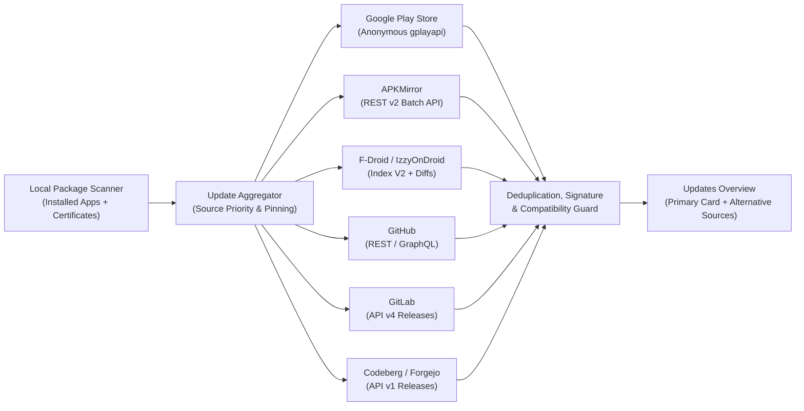

# 🌐 Update Sources, Repository Linking & Signature Protection in ApkUp

This guide explains how ApkUp's update sources work together, how **Source Priority & Per-App Pinning** choose the best download, how **Pre-Release Channels** and **Signature Verification** protect your device, and how to link custom GitHub, GitLab, or Codeberg/Forgejo repositories.

> Looking for a specific error message (`HTTP 403`, `HTTP 429`, `DNS`, Cloudflare, or `INSTALL_FAILED_UPDATE_INCOMPATIBLE`)? Jump straight to **[Troubleshooting Source Errors](https://github.com/DurchEins/apkup/wiki/Troubleshooting-Source-Errors)**.

---

## 📑 Table of Contents
1. [🟢 Part 1: Explained Simply for Everyone](#-part-1-explained-simply-for-everyone)
   - [1.1 Which update sources does ApkUp search?](#11-which-update-sources-does-apkup-search)
   - [1.2 Direct In-App Downloads from APKMirror](#12-direct-in-app-downloads-from-apkmirror)
   - [1.3 What is an "App Signature" and why does it matter?](#13-what-is-an-app-signature-and-why-does-it-matter)
   - [1.4 Multi-Source Priority & Per-App Pinning](#14-multi-source-priority--per-app-pinning)
   - [1.5 Guide: Linking a Custom GitHub, GitLab, or Codeberg Project](#15-guide-linking-a-custom-github-gitlab-or-codeberg-project)
2. [💻 Part 2: Technical Documentation for Experts & Power Users](#-part-2-technical-documentation-for-experts--power-users)
   - [2.1 Parallel Multi-Source Aggregation & Version Verification](#21-parallel-multi-source-aggregation--version-verification)
   - [2.2 Cryptographic Signature Verification (SHA-1 & SHA-256) & Origin Detection](#22-cryptographic-signature-verification-sha-1--sha-256--origin-detection)
   - [2.3 Direct APKMirror Resolution & Hardened `.apkm` Split Extraction](#23-direct-apkmirror-resolution--hardened-apkm-split-extraction)
   - [2.4 Google Play Store Dispenser Resilience & HTTP 429 Recovery](#24-google-play-store-dispenser-resilience--http-429-recovery)
   - [2.5 Three-Tier Repository Resolution for GitHub, GitLab & Codeberg](#25-three-tier-repository-resolution-for-github-gitlab--codeberg)
3. [❓ Part 3: Frequently Asked Questions (FAQ)](#-part-3-frequently-asked-questions-faq)
   - [3.1 Why does ApkUp show a warning icon for a "Signature Conflict"?](#31-why-does-apkup-show-a-warning-icon-for-a-signature-conflict)
   - [3.2 Do I need a Google account for Play Store updates?](#32-do-i-need-a-google-account-for-play-store-updates)
   - [3.3 Why does APKMirror sometimes open an in-app WebView or my browser?](#33-why-does-apkmirror-sometimes-open-an-in-app-webview-or-my-browser)
   - [3.4 What are `.apkm` files and can ApkUp install them directly?](#34-what-are-apkm-files-and-can-apkup-install-them-directly)
   - [3.5 How do I manage Alpha / Beta pre-releases (for apps and ApkUp itself)?](#35-how-do-i-manage-alpha--beta-pre-releases-for-apps-and-apkup-itself)
   - [3.6 Does ApkUp support self-hosted GitLab and Forgejo servers?](#36-does-apkup-support-self-hosted-gitlab-and-forgejo-servers)
4. [🔗 Part 4: Related Guides & Troubleshooting](#-part-4-related-guides--troubleshooting)

---

## 🟢 Part 1: Explained Simply for Everyone

### 1.1 Which update sources does ApkUp search?
ApkUp unites six independent update channels in a single interface. You can enable or disable each source individually in **Setup**:

| Source | Best For | Key Highlight in ApkUp |
| :--- | :--- | :--- |
| **Google Play Store** | Everyday mainstream apps | Works completely anonymously without signing into a personal Google account. |
| **APKMirror** | Fast rollouts before Play Store stages reach you | Verifies architecture, Android version, and signatures automatically with per-app Cloudflare cooldowns. |
| **F-Droid & IzzyOnDroid** | Free & Open-Source Software (FOSS) | Unified bottom sheet with Index V2 (`entry.jar` / `index-v1.jar`) verification, pre-pinned presets, and TOFU pinning for custom repos. |
| **GitHub** | Open-source apps straight from developers | Built-in catalog + custom repo bindings, optional regex asset filter, GraphQL batching, and token testing. |
| **GitLab** | Projects hosted on GitLab (Aurora Store, VLC, Briar) | Supports `gitlab.com`, self-hosted instances, and nested subgroups. |
| **Codeberg / Forgejo** | Community FOSS apps (e.g., Gadgetbridge) | Supports `codeberg.org`, self-hosted Forgejo instances, and optional access tokens. |

[⬆️ Back to Table of Contents](#-table-of-contents)

---

### 1.2 Direct In-App Downloads from APKMirror
When **Direct APKMirror Downloads** is enabled under **Setup ➔ APKMirror**, ApkUp resolves the download link in the background, downloads the APK or `.apkm` bundle directly inside the app, and installs it without forcing you through ad-heavy browser pages.
- If Cloudflare triggers an interactive check, ApkUp opens a compact **in-app WebView** first and only falls back to your system browser if needed.

[⬆️ Back to Table of Contents](#-table-of-contents)

---

### 1.3 What is an "App Signature" and why does it matter?
Every Android app carries an invisible cryptographic seal from its developer — its **digital signature**.
- Android **only** allows an update if the new APK has the exact same signature as the installed app.
- **How ApkUp protects you:** ApkUp checks signatures during update discovery and again before installation (`minSdk`, `ABI`, and signing certificate), blocking tampered or mismatched updates before Android fails on them.

[⬆️ Back to Table of Contents](#-table-of-contents)

---

### 1.4 Multi-Source Priority & Per-App Pinning
When an app offers updates on multiple sources simultaneously, ApkUp keeps your **Updates** list clean by showing each app once:
- **Global Source Priority:** Open **Setup ➔ Source Priority** and reorder sources via drag-and-drop or arrow buttons to choose your preferred default order.
- **Per-App Source Pinning:** In **Apps** or **Updates**, pin an individual app to a specific source (e.g., always prefer GitHub over Play Store). If the pinned source currently has no update, ApkUp automatically falls back to your global order.
- **Alternative Sources:** Tap any update card to view all other sources offering that update and switch with one tap.

[⬆️ Back to Table of Contents](#-table-of-contents)

---

### 1.5 Guide: Linking a Custom GitHub, GitLab, or Codeberg Project
1. Open the **Apps** tab and tap the desired app.
2. Select **Link Repository (GitHub / GitLab / Codeberg)**.
3. Paste the full repository URL or shorthand (`owner/repo` for GitHub/Codeberg, `group/subgroup/project` for GitLab, plus custom host if self-hosted).
4. Optionally add an **APK Asset Regex** (with live test preview) if the release ships multiple APK variants, then tap **Save**.

[⬆️ Back to Table of Contents](#-table-of-contents)

---

## 💻 Part 2: Technical Documentation for Experts & Power Users

### 2.1 Parallel Multi-Source Aggregation & Version Verification
ApkUp queries all enabled sources concurrently and in isolation, so one slow or unreachable provider never blocks the others:

**Two-Stage Version Verification + Compatibility Guard:**
1. Strictly higher Android `versionCode` (when provided by the source) and semantic version progression.
2. Pre-install compatibility check verifying device `minSdk`, supported CPU `ABI`s, and signing certificates before launching installation.

[⬆️ Back to Table of Contents](#-table-of-contents)

---

### 2.2 Cryptographic Signature Verification (SHA-1 & SHA-256) & Origin Detection
ApkUp computes both **SHA-1** and **SHA-256** signing fingerprints via `PackageManager` (`GET_SIGNING_CERTIFICATES` on API 28+):
- **APKMirror:** Strictly matches the remote SHA-1 fingerprint against the installed app.
- **F-Droid / IzzyOnDroid:** Matches the local certificate against the `signer` SHA-256 hash recorded in the repository index.
- **Install Origin Detection:** Uses `PackageManager.getInstallSourceInfo()` to flag cross-source signature mismatches proactively.
- **Local Export Exception:** When using **Save APK**, file/archive/SHA-256 integrity is verified without blocking export if the installed app uses a different signer.

[⬆️ Back to Table of Contents](#-table-of-contents)

---

### 2.3 Direct APKMirror Resolution & Hardened `.apkm` Split Extraction
1. **Three-Stage Link Resolution:** Variant page ➔ time-signed download page ➔ final CDN stream.
2. **Cooldown & Anti-Bot Handling:** Enforces per-app 10-minute cooldowns on failures, opens an in-app Cloudflare WebView when interactive verification is needed, and falls back to the system browser if still blocked.
3. **Hardened `.apkm` Extraction:** Inspects true ZIP structure (`AndroidManifest.xml` at root vs. embedded split `.apk`s), rejects Zip-Slip (`..` / path traversal) entries, and writes atomic `.part` downloads before finalizing.

[⬆️ Back to Table of Contents](#-table-of-contents)

---

### 2.4 Google Play Store Dispenser Resilience & HTTP 429 Recovery
Anonymous Play Store queries use shared guest sessions via Aurora Dispenser. On `HTTP 429`, ApkUp rotates the guest session in a synchronized manner with cooldown protection so concurrent downloads share the refreshed session without flooding the dispenser.

[⬆️ Back to Table of Contents](#-table-of-contents)

---

### 2.5 Three-Tier Repository Resolution for GitHub, GitLab & Codeberg
1. **Priority 1 – Custom User Bindings:** Manually linked repositories (plus optional asset regex).
2. **Priority 2 – Built-in Project Catalog:** Curated package-to-repo mappings bundled with ApkUp.
3. **Priority 3 – Automatic Source Discovery & FOSS Flavor Heuristic:** Upstream URLs discovered from F-Droid/IzzyOnDroid indexes, preferring FOSS builds for F-Droid-origin apps and deprioritizing `-debug` / incompatible artifacts.

[⬆️ Back to Table of Contents](#-table-of-contents)

---

## ❓ Part 3: Frequently Asked Questions (FAQ)

### 3.1 Why does ApkUp show a warning icon for a "Signature Conflict"?
Apps compiled by F-Droid use F-Droid's signing key, whereas GitHub or Play Store builds use the developer's or Google's key. Android forbids overwriting an app across different signing keys. Pick the matching source under **Alternative Sources**, or uninstall the existing app first if you want to switch signers.

### 3.2 Do I need a Google account for Play Store updates?
**No.** ApkUp uses anonymous guest sessions and never asks for your personal Google credentials.

### 3.3 Why does APKMirror sometimes open an in-app WebView or my browser?
APKMirror uses Cloudflare bot protection. When Cloudflare requires human verification, ApkUp opens an in-app WebView first (or falls back to your browser if running in the background) so you can still complete the download.

### 3.4 What are `.apkm` files and can ApkUp install them directly?
Yes! `.apkm` files are split APK bundles (base app + language/ABI/density splits). ApkUp extracts and installs all matching splits automatically.

### 3.5 How do I manage Alpha / Beta pre-releases (for apps and ApkUp itself)?
* **For Tracked Apps:** Open **Setup ➔ Include Pre-Releases** to enable individual channels (**Beta**, **RC**, **Alpha**, **Nightly**) globally, or override pre-release behavior per app inside its details sheet. By default, pre-releases are disabled.
* **For ApkUp Itself (Self-Updater):** Open **Setup ➔ About ➔ Receive beta updates** (disabled by default) to opt into ApkUp pre-release builds. Turning it off automatically returns you to the stable track with the next regular release.

### 3.6 Does ApkUp support self-hosted GitLab and Forgejo servers?
**Yes!** Both self-hosted GitLab (including nested subgroups) and self-hosted Forgejo instances over `https://` are supported when linking repositories.

---

## 🔗 Part 4: Related Guides & Troubleshooting

* 🚨 **[Troubleshooting Source Errors](https://github.com/DurchEins/apkup/wiki/Troubleshooting-Source-Errors)** — Solutions for `DNS`, `Timeout`, `HTTP 401/403/429/404`, Cloudflare, signature conflicts & asset matching.
* 📦 **[F-Droid & Index V2 Repositories](https://github.com/DurchEins/apkup/wiki/F-Droid-&-Index-V2-Repositories)** — Index V2, incremental diffs, presets, and TOFU pinning.
* 🔑 **[Configuring GitHub, GitLab & Codeberg Tokens](https://github.com/DurchEins/apkup/wiki/Configuring-GitHub-&-GitLab-Tokens)** — Raise rate limits and verify tokens live.
* ⚡ **[Shizuku & Background Installation](https://github.com/DurchEins/apkup/wiki/Shizuku-&-Background-Installation)** — Silent installs & optional Root fallback.

[⬆️ Back to Table of Contents](#-table-of-contents)
